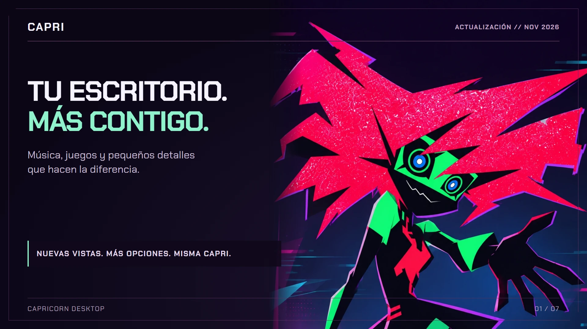
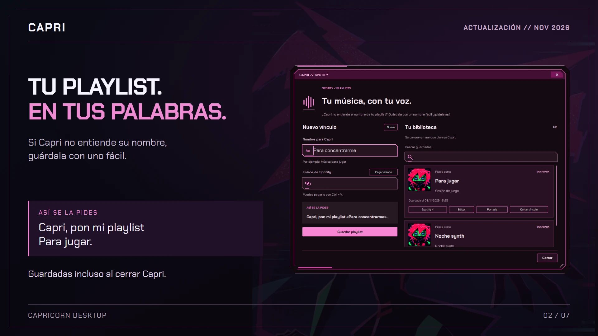
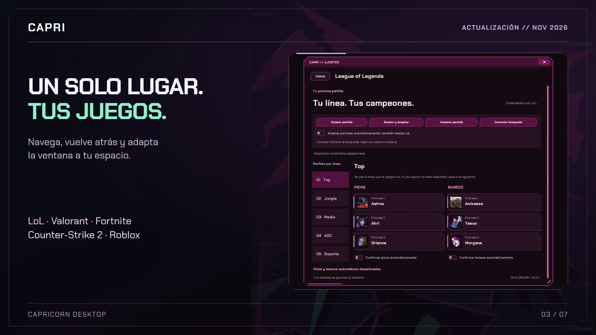
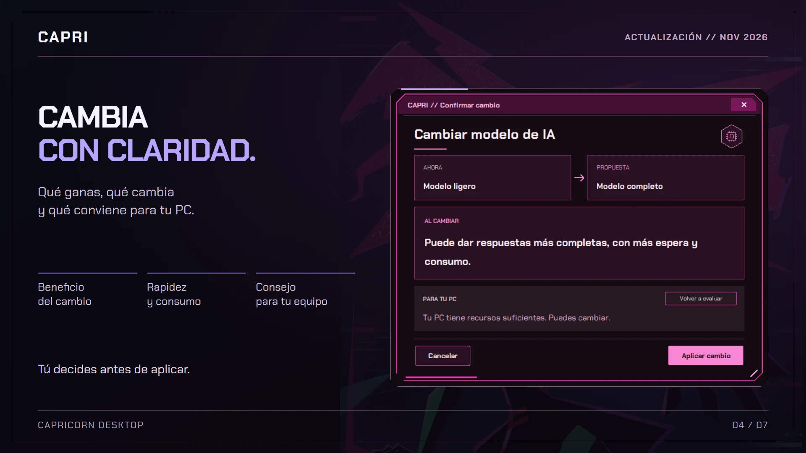
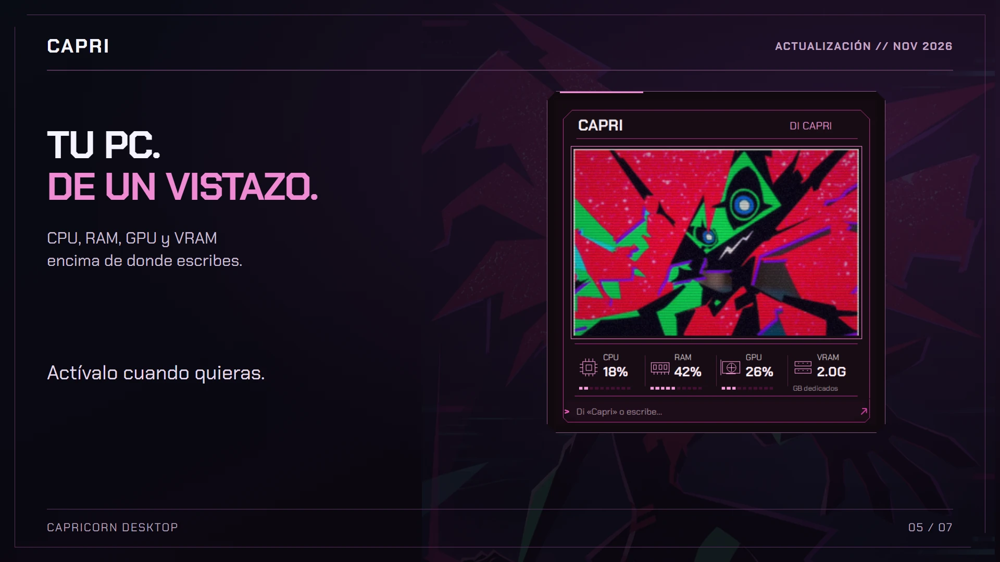
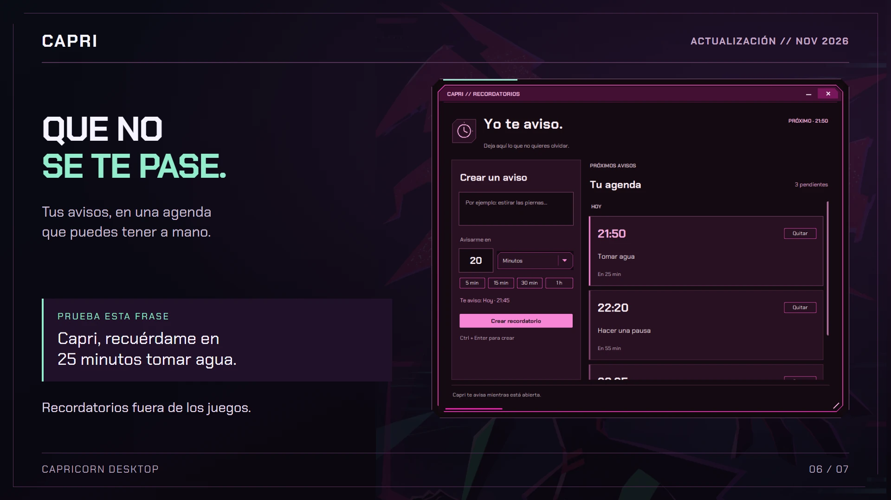
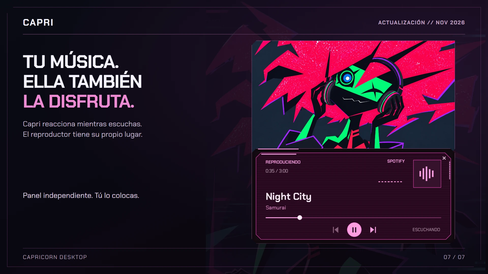

<p align="center">
  
</p>

<p align="center">
  <a href="https://github.com/TheSniperS2/Capri-Capricorn-Para-Escritorio/actions/workflows/tests.yml"></a>
  
  
  
  <a href="LICENSE"></a>
</p>

<h1 align="center">Capri, de Cyberpunk a tu escritorio.</h1>

<p align="center">
  <b>Habla con ella. Pon tu música. Que no se te pase la partida.</b><br>
  Voz, conversación con IA local y una compañera de escritorio con la estética de <i>Cyberpunk: Edgerunners</i>.
</p>

<p align="center">
  <a href="#empieza-a-usarla"><b>Instalar Capri</b></a> ·
  <a href="#capri-en-acción">Verla en acción</a> ·
  <a href="#componentes-mínimos-y-recomendados">Requisitos</a> ·
  <a href="docs/README.md">Documentación</a> ·
  <a href="https://github.com/TheSniperS2/Capri-Capricorn-Para-Escritorio/releases">Releases</a>
</p>

---

## Novedades de esta actualización

**Playlists con nombres fáciles, ajustes reunidos y ventanas que se adaptan a tu escritorio.** Esta actualización también aclara los cambios de IA y reconocimiento: Capri explica el beneficio, el coste y una recomendación orientativa según los recursos de tu equipo, antes de aplicar nada.

<p align="center">
  <a href="docs/media/novedades-2026-11/horizontal/02-playlists.webp"></a>
  <a href="docs/media/novedades-2026-11/horizontal/03-juegos.webp"></a>
</p>
<p align="center">
  <a href="docs/media/novedades-2026-11/horizontal/04-confirmaciones.webp"></a>
  <a href="docs/media/novedades-2026-11/horizontal/05-monitor.webp"></a>
</p>
<p align="center">
  <a href="docs/media/novedades-2026-11/horizontal/06-recordatorios.webp"></a>
  <a href="docs/media/novedades-2026-11/horizontal/07-multimedia.webp"></a>
</p>

<p align="center"><sub>Abre cualquier imagen para verla completa. Formato horizontal 1920 × 1080 para el README; también se conservan las versiones verticales 1080 × 1920 para TikTok. Capturas de la aplicación con datos de demostración y arte promocional. <a href="docs/media/novedades-2026-11/README.md">Galerías, procedencia y archivos editables</a>.</sub></p>

- **Spotify:** biblioteca de vínculos guardados, búsqueda, edición y portadas. Los nombres fáciles se conservan al reiniciar. Si Spotify no comparte la portada de una playlist privada, puedes seleccionar su imagen con **Portada → Capturar**.
- **Ajustes y juegos:** LoL, Valorant, Fortnite, Counter-Strike 2 y Roblox en la misma ventana, con **Volver**. Apertura optimizada y contenido adaptable al redimensionar.
- **Cambios de modelos:** confirmaciones breves, sin scroll, con ventajas, costes y consejo para tu PC. Puedes cancelar o volver a evaluar antes de decidir.
- **Tu escritorio:** monitor de recursos opcional, agenda de recordatorios y reproductor que puedes mover de forma independiente. **Más → Playlists de Spotify** abre la biblioteca sin pasar por Ajustes.

## Capri en acción

### Tu música, con tu voz

**«Capri, reanuda YouTube».** Controla el vídeo que tienes abierto o elige un resultado de búsqueda. El [puente de Opera y Opera GX](docs/CONECTAR_OPERA.md) conecta Capri con el reproductor y los resultados de YouTube.

<p align="center">
  <a href="docs/media/readme/capri-youtube.webp"></a>
</p>

**«Pausa Spotify». «Siguiente canción». «Pon mi playlist Para jugar».** Si el nombre original tiene símbolos o Capri no lo entiende, [guarda un nombre fácil y su enlace](docs/PLAYLISTS_GUARDADAS.md). No cambia el nombre en Spotify y el vínculo se conserva aunque cierres Capri. La biblioteca muestra lo que guardaste y permite editarlo o quitarlo.

En **Ajustes → Multimedia** puedes activar un reproductor flotante con miniatura, título, progreso y controles de Spotify o del navegador. Capri se mueve de forma independiente: puedes sentarla sobre su borde o dejar que se suba durante sus paseos. En modo pantalla disfruta la música dentro del visor. [Cómo usar el panel](docs/USO.md#panel-multimedia).

**Automático** prioriza la sesión que está reproduciendo. Si detecta dos activas, mantiene la primera que observó reproduciendo hasta que se pausa. También puedes elegir Spotify o navegador como fuente preferida. La biblioteca de playlists tiene su propia ventana: cerrar Ajustes no la cierra.

<p align="center">
  <a href="docs/media/readme/capri-spotify.webp"></a>
</p>

### Sale partida. Capri la acepta.

Activa la **aceptación automática de LoL** y busca desde Capri o desde el propio cliente. Vigila las próximas colas mientras esté abierta; puedes desactivarla cuando quieras. También admite buscar, aceptar y cancelar por voz. [Cómo configurarlo](docs/LEAGUE_OF_LEGENDS.md).

<p align="center">
  <a href="docs/media/readme/capri-lol.webp"></a>
  <br><sub>Vigilancia activada en el cliente real. La captura no muestra una partida aceptada. El nuevo panel permite configurar picks y baneos por línea; Capri no juega por ti.</sub>
</p>

### Una compañera con su propio estilo

Elige **pantalla flotante o personaje de escritorio** desde el clic derecho. Personaliza el aspecto, el tamaño y los colores desde sus accesos. En modo personaje puede moverse, caer y sujetarse a ventanas compatibles; también se asoma por los bordes y tiene llamadas con invitados. En **Ajustes → Escritorio** decides qué interacciones quieres activar.

En modo pantalla, activa **Mostrar recursos del computador** para ver CPU, RAM, GPU y VRAM justo encima del campo de escritura. El monitor forma parte de la misma ventana y acompaña su movimiento. Es opcional; la información disponible depende de lo que Windows pueda leer.

Abre **Más → Recordatorios** para ver tu agenda o di **«Capri, recuérdame en 25 minutos tomar agua»**. Los avisos son generales, se conservan entre sesiones y puedes cancelarlos individualmente. Capri debe estar abierta para entregarlos.

<p align="center">
  
  
</p>

La intro aparece sujetando la pantalla y se transforma en el visor. Al cerrar, la despedida llena la pantalla con su efecto de cámara, sincroniza la boca con la voz y da paso a la mano y la estrella. Puedes desactivar las animaciones desde Ajustes.

<p align="center">
  
</p>

<p align="center"><sub>Composiciones con capturas de la aplicación y de los servicios abiertos. <a href="docs/media/readme/README.md">Procedencia y alcance de las imágenes</a>.</sub></p>

## También puedes…

| | Con Capri |
| :--- | :--- |
| **Conversar** | Usa texto o voz y elige un modelo de **Ollama local**. Las órdenes directas funcionan también sin IA. |
| **Hablar en cuatro idiomas** | Español, inglés, portugués de Brasil y japonés, con su voz correspondiente. |
| **Continuar una conversación** | Escucha opcional después de una pregunta de Capri, para responder sin repetir su nombre. También existe un modo de escucha continua. |
| **Ver tus recursos** | Monitor opcional de CPU, RAM, GPU y VRAM integrado sobre la entrada de texto. |
| **Guardar recordatorios** | Pide un aviso por voz o administra su plazo y texto en la agenda. |
| **Controlar Discord** | Silencia tu micrófono o pide entrar en un canal de voz del servidor abierto. |
| **Moverte por el escritorio** | Abre aplicaciones y sitios, controla ventanas y gestiona archivos con los permisos correspondientes. |
| **Elegir sus límites** | El control ampliado es opcional; las acciones sensibles piden confirmación. Puedes desactivar movimientos, asomos y llamadas. |

## Empieza a usarla

Necesitas **Windows 10/11 y Python 3.12 de 64 bits**. La primera preparación requiere internet. **Para obtener la versión que muestran las capturas, usa el ZIP de `main` y genera su lanzador con los pasos siguientes.** Un lanzador descargado anteriormente contiene la versión de cuando se publicó; volver a abrirlo no descarga el código nuevo.

### 1. Instala Python 3.12

Abre la [página oficial de Python 3.12.10](https://www.python.org/downloads/release/python-31210/) y, en **Files**, elige **Windows installer (64-bit)**. Es el instalador tradicional que utiliza esta guía; evita elegir otra versión o el paquete de Microsoft Store. Hemos recibido un fallo de creación del entorno con la versión de Store y su redirección de carpetas.

Ejecuta el instalador, marca **Add python.exe to PATH** y deja activados el lanzador de Python, `pip` y Tcl/Tk. No basta con descargar el archivo: hay que completar la instalación.

Cierra las terminales que tengas abiertas. Pulsa **Windows + R**, escribe `powershell` y pulsa Enter. En esa ventana pega:

```powershell
py -3.12 --version
```

Debe responder **Python 3.12.x**. Si dice que `py` no se reconoce o **No suitable Python runtime found**, revisa la [ayuda de instalación](docs/INSTALACION.md) antes de continuar. Los comandos van en PowerShell, donde aparece `PS C:\...>`; si ves `>>>`, estás dentro de Python: cierra esa ventana.

### 2. Descarga y extrae Capri

[Descarga el ZIP actualizado de `main`](https://github.com/TheSniperS2/Capri-Capricorn-Para-Escritorio/archive/refs/heads/main.zip). En el Explorador, pulsa **Extraer todo** y abre la carpeta extraída. Entra hasta ver **`empaquetar.py`**, junto a `assets`, `docs` y `src`. Si Windows oculta las extensiones, el archivo aparece como **empaquetar**.

Haz clic en la **barra de dirección del Explorador**, escribe `powershell` y pulsa Enter. Así abres la terminal en la carpeta correcta. Si todavía ves **Herramientas de carpeta comprimida**, vuelve a la carpeta extraída.

### 3. Genera el lanzador

Pega **solo este comando** y espera a que termine:

```powershell
py -3.12 empaquetar.py
```

Se creará la carpeta **`dist`** con **`Abrir Capri.pyw`**. Es normal que ese lanzador no aparezca antes de ejecutar el comando. Si hay un error, detente y consulta la [guía de solución de problemas](docs/INSTALACION.md).

### 4. Instala y abre Capri

En la misma ventana de PowerShell, ejecuta ahora este otro comando:

```powershell
py -3.12 ".\dist\Abrir Capri.pyw"
```

Espera la preparación inicial: instala las dependencias y descarga los modelos de reconocimiento. Después crea el acceso directo **Capri** en el escritorio. No requiere administrador ni se añade automáticamente al inicio de Windows.

En **Ajustes → Micrófono**, selecciona tu entrada y ajusta la sensibilidad. Di **«Capri, abre la calculadora»** o pulsa **F8** para hablar. Para conversar, activa Ollama desde **Ajustes → IA y servicios**.

**Para actualizar:** cierra Capri, descarga y extrae de nuevo el ZIP de `main` y repite los pasos 3 y 4 desde esa carpeta nueva. Usa el lanzador recién generado en `dist`, no el antiguo de Descargas. Al actualizar sobre la misma instalación conserva las preferencias.

<details>
<summary><b>¿Prefieres una Release ya empaquetada?</b></summary>

Las [Releases](https://github.com/TheSniperS2/Capri-Capricorn-Para-Escritorio/releases) pueden ir por detrás de `main`. Comprueba la fecha y sus notas: las capturas de esta página corresponden a `main`.

Con Python 3.12 ya instalado, descarga **Abrir Capri.pyw** de la Release elegida; GitHub puede llamarlo `Abrir.Capri.pyw`. Abre PowerShell en la carpeta donde lo descargaste y ejecuta `py -3.12 "Abrir.Capri.pyw"`, usando el nombre exacto del archivo. No necesitas `empaquetar.py` para esa descarga. Ese lanzador instala la versión de esa Release y también requiere internet para la primera preparación.

</details>

¿Aparece **«No se pudo completar la preparación»**? Consulta [errores frecuentes y cómo abrir el registro](docs/INSTALACION.md#no-se-pudo-completar-la-preparación).

## Componentes mínimos y recomendados

**Puedes usar Capri sin una tarjeta gráfica dedicada.** La carga adicional depende sobre todo de si activas IA local, del tamaño del modelo y del reconocimiento de voz elegido.

| Componente | Punto de partida · personaje y órdenes | Recomendado · voz + IA local pequeña | Más margen · juegos + IA local |
| :--- | :--- | :--- | :--- |
| **Procesador** | CPU x64, 2 núcleos / 4 hilos | 4 núcleos / 8 hilos; AVX2 recomendado | 6 núcleos / 12 hilos o superior |
| **RAM del equipo** | 8 GB | 16 GB para Whisper base y un modelo de unos 3B cuantizado | 32 GB para juegos o modelos de 7B–8B |
| **Gráficos** | Integrados | GPU opcional; la IA también funciona por CPU, con más espera | GPU compatible con Ollama; unos 8 GB de VRAM o más dan margen según el modelo |
| **Espacio libre** | Reserva unos 4 GB para entorno y reconocimiento | SSD y unos 12 GB, incluyendo Ollama y un modelo pequeño | SSD y 20 GB o más para varios modelos |
| **Pantalla** | 1280 × 720 | 1920 × 1080 | Según tu escritorio |
| **Audio** | Salida de audio; micrófono para hablarle | Micrófono con poco ruido | Igual que el recomendado |

Estas cifras son una **guía orientativa, no mínimos de rendimiento certificados**. No se garantiza una latencia concreta: influyen el modelo, la memoria disponible y los otros programas abiertos. Para empezar con IA, una combinación equilibrada es **16 GB de RAM, SSD, Whisper base y un modelo de unos 3B**. El instalador propone `llama3.2:3b` si todavía no elegiste otro.

Ollama requiere **Windows 10 22H2 o posterior**, al menos 4 GB para su instalación y espacio adicional para los modelos. Comprueba sus [requisitos de Windows](https://docs.ollama.com/windows) y [GPU compatibles](https://docs.ollama.com/gpu). El reconocimiento de Capri usa Whisper por **CPU/int8**; una GPU para Ollama no acelera automáticamente ese reconocimiento. Base es más ligero que Small; consulta también las [mediciones de faster-whisper](https://github.com/SYSTRAN/faster-whisper#benchmark).

## Prueba estas frases

Di «Capri» y la petición en una misma frase, o utiliza la tecla para hablar. **F8** es la tecla inicial y puedes cambiarla en Ajustes. **Esc** detiene la respuesta o cancela una animación compatible.

| Para… | Puedes decir… |
| :--- | :--- |
| Abrir una aplicación | «Capri, abre la calculadora». |
| Ir a un sitio | «Abre YouTube» o «abre Netflix». |
| Controlar música | «Pausa Spotify» o «siguiente canción». |
| Elegir un vídeo | «Reproduce el segundo resultado en YouTube». |
| Silenciarte en Discord | «Mutéame el Discord» o «desmutéame en Discord». |
| Entrar en un canal de voz | «Únete al canal de voz General del servidor Amigos en Discord». |
| Vigilar partidas de LoL | «Activa la aceptación automática del LoL». |
| Usar la cola de LoL | «Busca partida en LoL» o «acepta partida en LoL». |
| Buscar en Valorant | «Busca partida en Valorant» o «cancela la cola en Valorant». |
| Abrir un favorito de Roblox | «Abre The Maze en Roblox» — después de guardarlo como favorito. |
| Pedir un aviso | «Recuérdame en 25 minutos tomar agua». |
| Ver la agenda | «Abre mis recordatorios». |
| Opinar sobre una skin | «¿Qué te parece esta skin?» — con su selección visible en Fortnite o Valorant. |
| Conversar | «Cuéntame algo» — con IA local activada. |
| Apagar el equipo | «Apaga el computador» — con control ampliado y confirmación. |

Las órdenes dependen de la aplicación y de sus controles disponibles. Capri informa cuando no puede confirmar una acción. No opera cualquier programa de cualquier manera.

## Configúrala a tu manera

El idioma se elige en **Ajustes → Escritorio**. **Ajustes → Voz** reúne volumen y velocidad; bajar el volumen a cero silencia a Capri. Español conserva la voz Dalia de Capri. En inglés existen las opciones **Capri V1** y **Capri V2**; sus versiones personales requieren recursos preparados. Los perfiles, muestras y modelos personales no se incluyen en la descarga pública. Sin ellos se utiliza la voz habitual del idioma. [Voces y disponibilidad](docs/VOZ_LOCAL.md).

Las opciones de cada juego están en **Ajustes → Juegos**, incluidas sus reacciones a skins y avisos. **Más** reúne accesos generales: playlists, YouTube, recordatorios, minimizar y cerrar. Los cambios de modelo de conversación o reconocimiento muestran una confirmación con sus efectos y una recomendación orientativa para el equipo.

| Integración | Qué necesitas | Guía |
| :--- | :--- | :--- |
| **IA local** | Ollama y un modelo instalado. Puedes elegir otro desde Ajustes. | [Modelos y reconocimiento](docs/COMPARACION_MODELOS.md) |
| **Micrófono** | Entrada seleccionada, permiso de Windows y modelo de reconocimiento. | [Voz y primeros pasos](docs/USO.md) |
| **Spotify** | Aplicación de escritorio y sesión iniciada. | [Uso y reproducción](docs/USO.md#elegir-dónde-reproducir-y-qué-resultado-abrir) |
| **YouTube** | Opera/Opera GX; el puente amplía los controles del reproductor y de resultados. | [Conectar Opera](docs/CONECTAR_OPERA.md) |
| **Discord** | Cliente de escritorio y sesión iniciada. Sus controles deben ser accesibles; para unirte, deja abierto el servidor. | [Discord](docs/USO.md#discord) |
| **League of Legends** | Cliente abierto y una sala preparada. Panel de picks y baneos por línea, búsqueda y aceptación automática opcionales. | [Configurar LoL](docs/LEAGUE_OF_LEGENDS.md) |
| **Valorant** | Juego abierto y sala preparada. Búsqueda, cancelación y tres preferencias de agente; confirmación automática opcional. | [Configurar Valorant](docs/VALORANT.md) |
| **Fortnite** | Control del lobby y avisos opcionales de rotación de tienda y misiones STW con pavos para fundadores. Algunas acciones requieren mostrar el juego. | [Configurar Fortnite](docs/FORTNITE.md) |
| **Counter-Strike 2** | Preferencias de mapas de Competitivo y órdenes explícitas para aplicar, buscar o cancelar. Requiere controles del cliente accesibles. | [Configurar CS2](docs/COUNTER_STRIKE.md) |
| **Roblox** | Favoritos, acceso a experiencias, comentarios sobre el avatar y acompañamiento según el contexto. | [Configurar Roblox](docs/ROBLOX.md) |

Las reacciones a skins de **Fortnite y Valorant** son opcionales y se ajustan por juego. El reconocimiento puede no identificar todas las selecciones. El acompañamiento en Roblox también depende de la experiencia y de lo que pueda detectar. Las preferencias de campeones, baneos, agentes y mapas son personales y no se distribuyen con el programa.

## Tus datos y tus permisos

| Función | Dónde se procesa |
| :--- | :--- |
| Conversación con un modelo instalado | En tu equipo, mediante Ollama local. |
| Reconocimiento del micrófono | En tu equipo, con los modelos descargados. |
| Voz natural habitual y base de Capri V1 | Microsoft recibe el texto que Capri va a leer. Requiere conexión. La conversión de timbre de V1 se realiza localmente cuando está preparada. |
| Capri V2, cuando está preparada | Generación local con sus recursos instalados; puede tardar bastante más. |
| Voz de Windows | En tu equipo, si tienes instalada una voz compatible con el idioma/acento. |
| Búsquedas y reproducción online | En los servicios que abras o controles. |
| Sala y agentes de Valorant | En tu cliente de Riot y sus servidores. Los tokens temporales solo permanecen en memoria. |

El **control ampliado viene desactivado**. Al habilitarlo, las operaciones sensibles requieren confirmar el objetivo; los borrados compatibles van a la Papelera. El modelo decide entre acciones definidas: sus respuestas no se ejecutan como código de consola. Discord usa la sesión ya abierta y no pide tu contraseña ni un token de cuenta.

Los ajustes, playlists vinculadas, diagnósticos y modelos descargados se guardan localmente y quedan fuera de Git. El historial del chat dura durante la sesión. Más detalles en la [guía de uso](docs/USO.md).

## Preguntas rápidas

<details>
<summary><b>¿Funciona sin Ollama?</b></summary>

Sí. El personaje y las órdenes directas no requieren conversación con un modelo. Ollama añade conversación e interpretación con contexto.

</details>

<details>
<summary><b>¿Funciona sin internet?</b></summary>

Después de descargar las dependencias y modelos, el reconocimiento y la conversación local pueden funcionar sin conexión. La voz natural, las descargas y los servicios web necesitan internet. Puedes usar una voz de Windows instalada para lectura local.

</details>

<details>
<summary><b>¿Las voces son las del anime?</b></summary>

Son voces sintéticas y perfiles preparados para la aplicación. No se garantiza una reproducción exacta de los intérpretes. La descarga pública no incluye las muestras ni los perfiles de voz personales; consulta [disponibilidad de las voces](docs/VOZ_LOCAL.md). La despedida usa la voz activa y los [perfiles invitados](docs/VOCES_INVITADAS.md) conservan su función.

</details>

<details>
<summary><b>¿Puedo apagar las llamadas o las travesuras?</b></summary>

Sí. En Ajustes → Escritorio puedes controlar los asomos, las llamadas y los paseos. La despedida animada se omite si desactivas las animaciones. Se retiró la opción de bromas que minimizan la ventana activa.

</details>

## Construyamos la siguiente versión

¿Tienes una idea para Capri o encontraste una frase que no entiende? Abre una [propuesta o reporte](https://github.com/TheSniperS2/Capri-Capricorn-Para-Escritorio/issues/new/choose) con los pasos, lo que esperabas y lo que ocurrió. Si te gusta el proyecto, una estrella ayuda a que más chooms lo encuentren.

**[Guía de contribución](CONTRIBUTING.md) · [Mapa del proyecto](docs/ARQUITECTURA.md) · [Cambios](CHANGELOG.md) · [Documentación completa](docs/README.md)**

<details>
<summary><b>Preparar el entorno de desarrollo</b></summary>

En Windows con Python 3.12:

```powershell
python -m venv .venv
.\.venv\Scripts\python.exe -m pip install -r requirements.txt
.\.venv\Scripts\python.exe empaquetar.py
.\.venv\Scripts\python.exe scripts/ejecutar_pruebas.py
```

Modifica los módulos de `src/`; `dist/` es una salida generada y no se versiona. Las pruebas automatizadas no sustituyen las comprobaciones de micrófono e integraciones reales. La [procedencia de los medios](docs/media/readme/README.md) distingue las capturas actuales de los recursos históricos generados por script.

</details>

---

<p align="center"><b>«Cuídate mucho, choom.»</b></p>

Proyecto de aficionado, independiente y **no oficial**. El código original está bajo [licencia MIT](LICENSE). Los personajes, marcas e imágenes de terceros conservan sus propios derechos; consulta [créditos y avisos](THIRD_PARTY_NOTICES.md) y las [referencias visuales](docs/REFERENCIAS.md). Las ilustraciones derivadas y sus prompts se documentan en [arte y animación](docs/ARTE_ANIMADO.md).
