# Capri · Novedades

La misma serie tiene dos composiciones: **1920 × 1080 (16:9) para el README** y **1080 × 1920 (9:16) para TikTok**. El texto y las capturas se redistribuyen para cada formato, conservando las proporciones. Pulsa una imagen para abrirla completa.

## Horizontales · README

[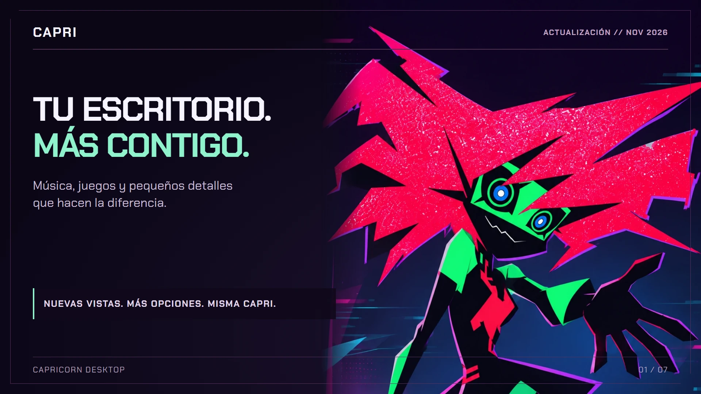](horizontal/01-capri.webp)

| | |
| --- | --- |
| [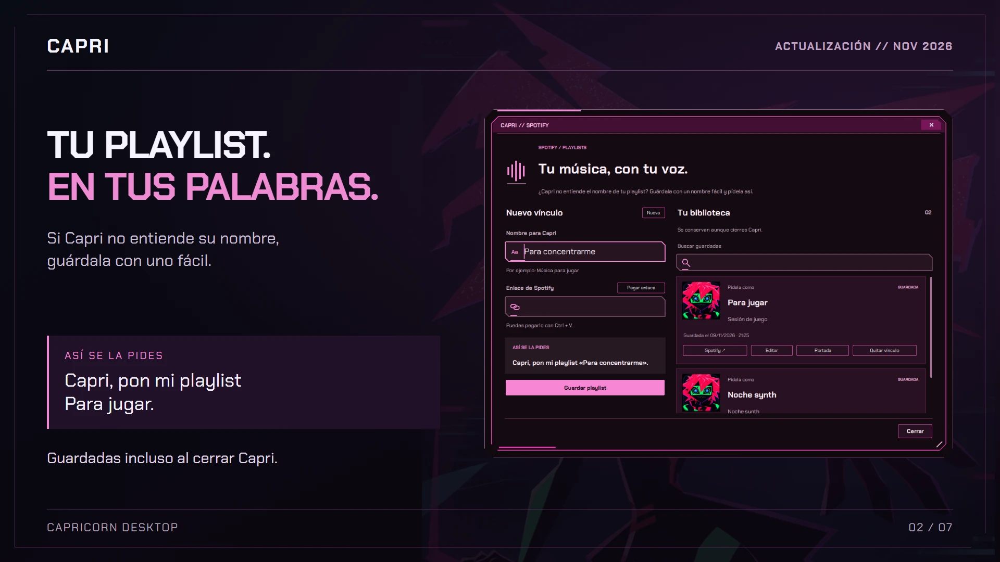](horizontal/02-playlists.webp) | [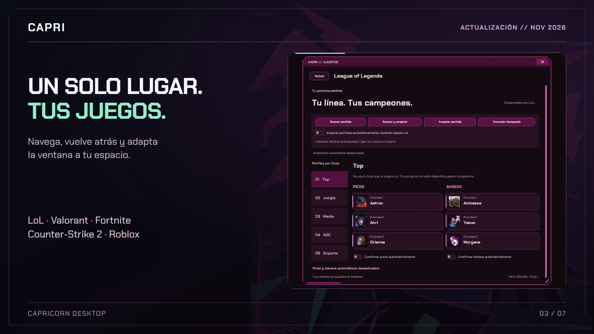](horizontal/03-juegos.webp) |
| [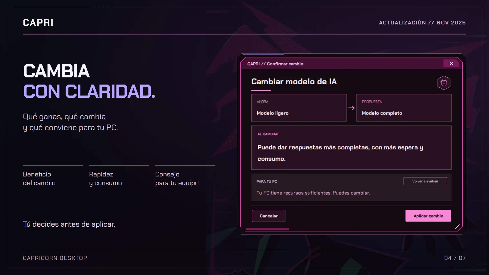](horizontal/04-confirmaciones.webp) | [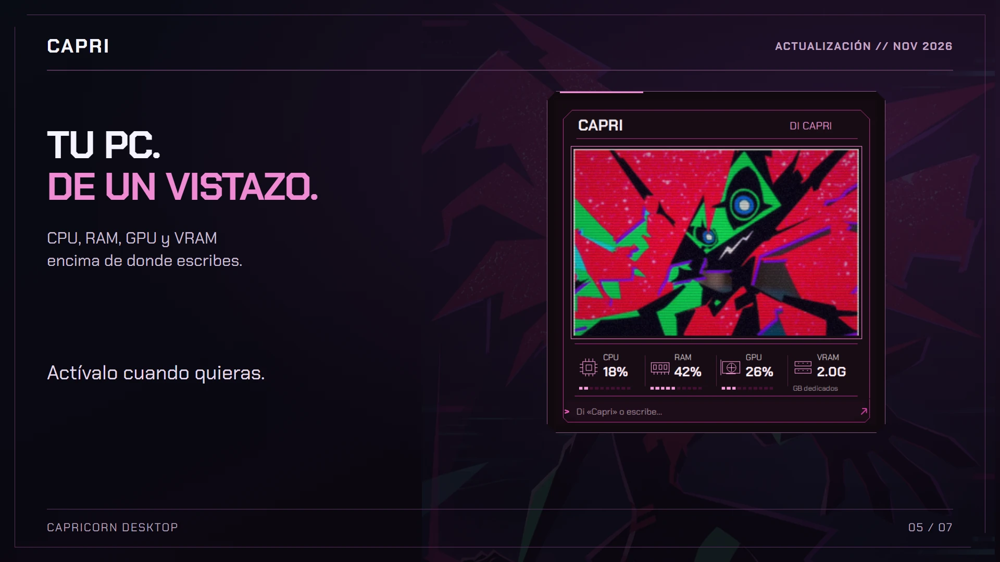](horizontal/05-monitor.webp) |
| [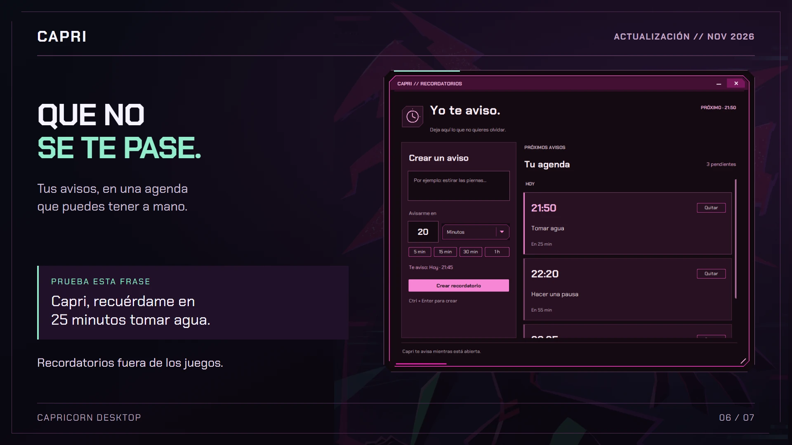](horizontal/06-recordatorios.webp) | [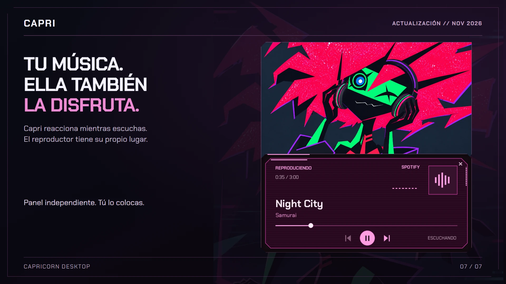](horizontal/07-multimedia.webp) |

## Verticales · TikTok

Se conservan las siete imágenes verticales originales.

| | | |
| --- | --- | --- |
| [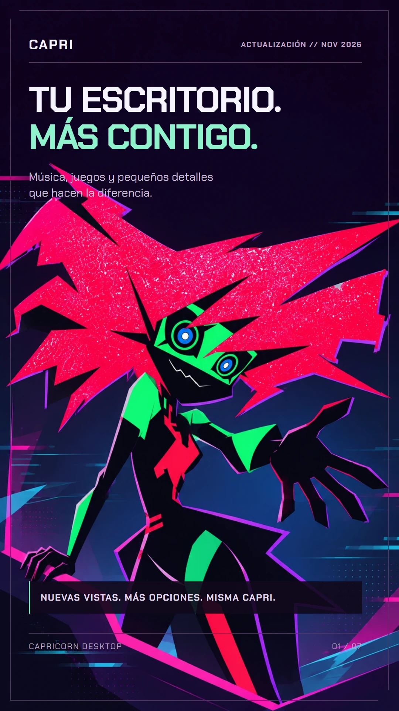](vertical/01-capri.webp) | [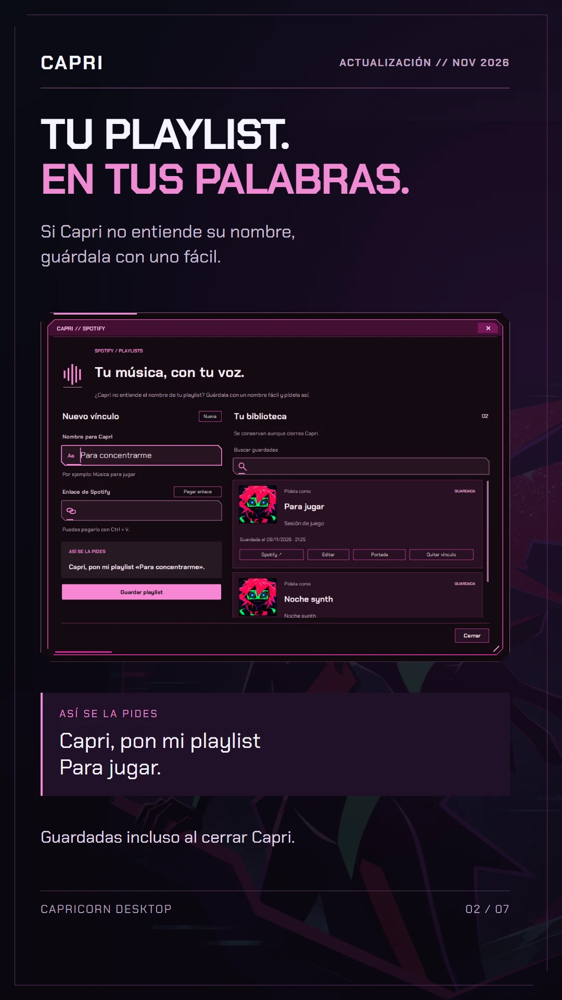](vertical/02-playlists.webp) | [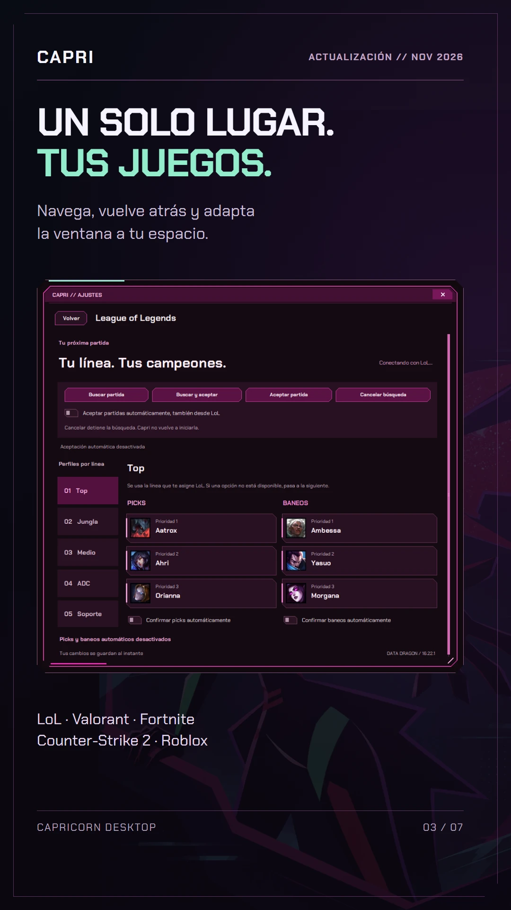](vertical/03-juegos.webp) |
| [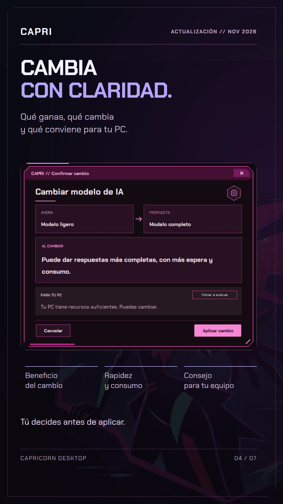](vertical/04-confirmaciones.webp) | [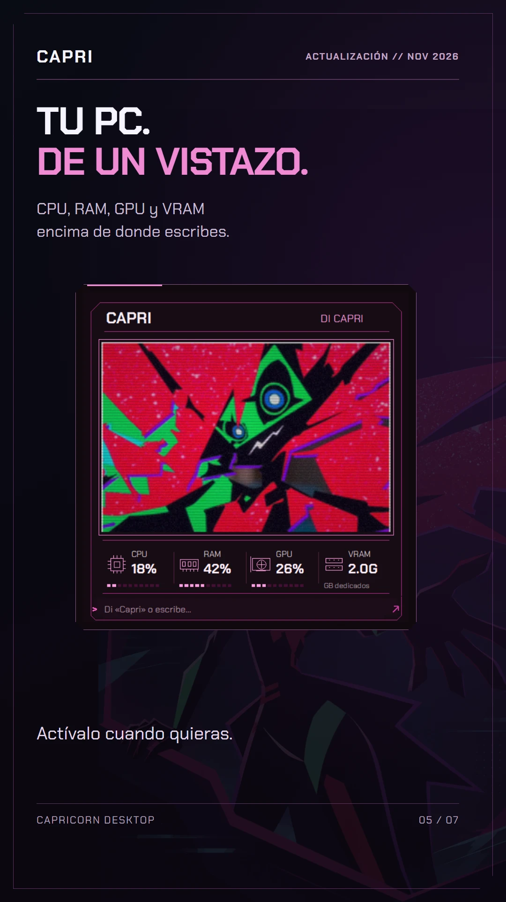](vertical/05-monitor.webp) | [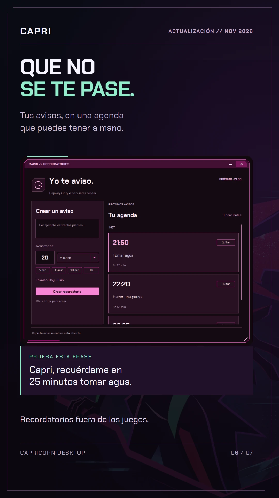](vertical/06-recordatorios.webp) |

[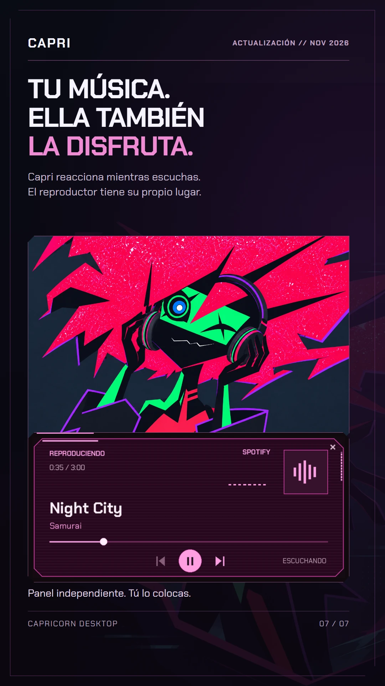](vertical/07-multimedia.webp)

## Qué muestran

1. **Capri:** portada de la actualización.
2. **Playlists:** biblioteca persistente y nombres fáciles para pedir música.
3. **Juegos:** LoL, Valorant, Fortnite, Counter-Strike 2 y Roblox dentro de Ajustes.
4. **Confirmaciones:** beneficio, coste y orientación según los recursos del equipo.
5. **Monitor:** CPU, RAM, GPU y VRAM encima del campo de escritura, activable en Ajustes.
6. **Recordatorios:** agenda general y creación de avisos por voz.
7. **Multimedia:** reproductor independiente y arte de escucha del modo pantalla.

## Procedencia y alcance

- `arte-capri.webp` es una **ilustración promocional nueva**, generada con la herramienta integrada ImageGen a partir de referencias del diseño de Capri. No es una captura ni un cambio del personaje instalado. El [prompt completo](PROMPT_ARTE.md) documenta la generación.
- Los PNG de `capturas/` muestran **controles reales de la aplicación**, capturados en ventanas propias con una instalación temporal y datos de demostración. No se utilizaron cuentas, preferencias, playlists, conversaciones ni datos de hardware de la instalación personal.
- Los nombres de playlists y sus identificadores son ejemplos. Sus portadas utilizan el icono incluido de Capri. No representan listas recuperadas de Spotify. La recomendación de modelos utiliza nombres y componentes de prueba; no es un diagnóstico de quien lee la imagen.
- El reproductor muestra una sesión sintética de ejemplo. No se abrió una cuenta de Spotify ni se inició música. LoL y Valorant se capturaron sin conexión al cliente y sin iniciar o aceptar partidas. Los recordatorios pertenecen a la instalación temporal. Los valores de CPU/RAM/GPU/VRAM son ejemplos.
- Las imágenes son composiciones editoriales con HTML/CSS, capturas y arte de presentación. No representan un pantallazo único del escritorio ni una prueba del reconocimiento por micrófono.
- El arte de escucha de la última lámina es el recurso existente `assets/capri-escuchando-musica-v3.png`, usado en modo pantalla. Las marcas y personajes conservan sus derechos; véanse [avisos de terceros](../../../THIRD_PARTY_NOTICES.md).

## Archivos y regeneración

El repositorio guarda **WebP** para reducir el peso, las capturas originales y los HTML/CSS editables de `horizontal/` y `vertical/`. Cada carpeta tiene su propia `VER-IMAGENES.html`. Para exportar PNG se necesita Chrome o Edge instalado; los scripts usan perfiles temporales y solo cargan documentos locales.

Desde el repositorio, con las dependencias de Capri:

```powershell
python scripts/capturar_novedades.py
python scripts/generar_novedades_verticales.py
python scripts/generar_novedades_horizontales.py
```

Cada exportación deja **siete PNG, una galería HTML y un ZIP** en su carpeta independiente: `Pictures/Capri/Novedades-2026-11-09-Vertical` o `Pictures/Capri/Novedades-2026-11-09-Horizontal`. Generar las horizontales no modifica las verticales. `--salida` permite elegir otra carpeta y `--sin-render` actualiza solo los HTML/CSS del formato elegido. El arte seleccionado ya está incluido; no se vuelve a generar ni se hace una llamada a un servicio de imágenes al exportar.

Los recursos antiguos de la [galería anterior](../readme/README.md) se conservan y tienen su propia procedencia.
